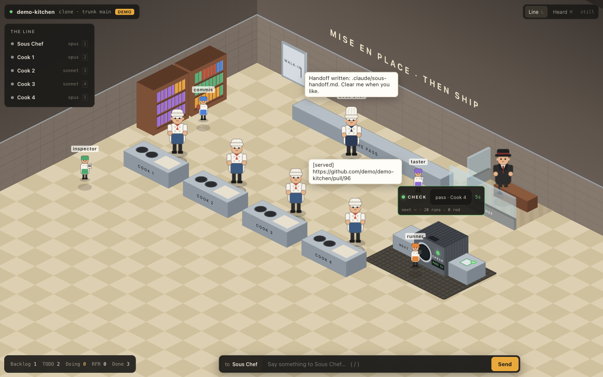

# The Brigade

[](https://github.com/mhmzdev/claude-code-brigade/actions/workflows/check.yml)
[](CHANGELOG.md)


Run a kitchen of Claude Code sessions on one machine. A **sous chef** session leads, a few
**line cook** sessions each work one ticket in their own **station** (a clone or worktree),
and you are the **head chef**: you approve feature plans and you merge. The sessions talk to
each other over `SendMessage`. No daemon, no queue, no database.

> Inspired by Steve Yegge's *[The Shape of Things to Come](https://yegge.ai/essays/the-shape-of-things-to-come/)*
> and *[Model Welfare for Agentic Engineers](https://yegge.ai/essays/model-welfare/)*.
> Gas Town is a city of agents. The Brigade is the same idea at the scale of one engineer
> and one laptop.

## Contents

- [Install](#install)
- [Set up a repo](#set-up-a-repo)
- [Run a service](#run-a-service)
- [The Window](#the-window)
- [Pause and resume](#pause-and-resume)
- [Run one skill yourself](#run-one-skill-yourself)
- [How work flows](#how-work-flows)
- [What's in the box](#whats-in-the-box)
- [Troubleshooting](#troubleshooting)
- [Feedback](#feedback)
- [Honest limits](#honest-limits)

## Install

```bash
brew install mhmzdev/brigade/bk
```

That gives you the `bk` command, with tmux and node behind it. You need
[Claude Code](https://claude.com/claude-code) installed and logged in. Use the full formula
name: Homebrew's own `bk` is an unrelated EPUB reader. macOS and Linux; on Windows use WSL.

Every session `bk` starts loads the plugin that came with it, so there is no marketplace
step and nothing to keep in step.

**Update**

```bash
brew update && brew upgrade mhmzdev/brigade/bk
bk stop && bk open          # a running session keeps the version it started with
```

[`CHANGELOG.md`](CHANGELOG.md) says what changed in each version.

<details>
<summary>Inside Claude Code, without <code>bk</code></summary>

The plugin alone, from the marketplace:

```
/plugin marketplace add mhmzdev/claude-code-brigade
/plugin install bk@claude-code-brigade
```

Or for your whole team, in `.claude/settings.json`:

```json
{
  "extraKnownMarketplaces": {
    "claude-code-brigade": {
      "source": { "source": "github", "repo": "mhmzdev/claude-code-brigade" }
    }
  },
  "enabledPlugins": { "bk@claude-code-brigade": true }
}
```

Every `bk` command below has a skill behind it, `/bk:<skill>`, shown in the same kind of
block. Update with `/plugin marketplace update claude-code-brigade` and
`claude plugin update bk@claude-code-brigade`, then restart every session.
</details>

## Set up a repo

Once per repo, at its root:

```bash
bk setup                    # asks one round of questions; nothing is committed until you say so
git add -A && git commit -m "chore: set up The Brigade" && git push
bk stations -n 3            # three stations, three cooks
```

`bk setup` writes the config (`.claude/brigade.md`), the ticket folders under `docs/` and a
short section in `CLAUDE.md`. It detects whether stations should be clones inside the repo
(`stations/`, gitignored) or worktrees next to it (`../<repo>-stations/`, for big repos and
workspaces), and says which; `bk setup --worktree` or `--clone` picks for it. Stations are
created from the pushed trunk, which is why the push comes first. Never run
`git clean -fdx` in a repo with clones inside it.

<details>
<summary>Inside Claude Code</summary>

```
/bk:setup                   # or /bk:setup --worktree, /bk:setup --clone
/bk:kitchen setup -n 3
```
</details>

## Run a service

```bash
bk open
```

That starts everything in one tmux session and puts you in front of the sous:

- the sous, already running `/bk:sous-chef`;
- one cook per station, already running `/bk:line-cook`, who find the sous and check in.

The sous picks the next ready ticket for each free cook, briefs it, answers its questions
from the record, reviews its diff before anything is committed, and tells you what it
assigned. You talk to the sous only, bar a grilling and an edit auto mode refuses (you
lift that in the cook's terminal). It comes to you for a yes on a feature plan (or any plan
that edits `.claude/`), and the merge.

| You want to | Type |
|---|---|
| leave the kitchen running and get your terminal back | `Ctrl-b d` |
| go back to the sous | `bk attach` |
| watch cook 2 work | `bk peek 2`, then `Ctrl-b d` |
| see what is up | `bk status` |
| the board: stations, files in flight, the rail, open questions | `bk board` |
| the questions waiting on you | `bk questions` |
| watch it all in the browser | `bk live` |
| pause everything for the day | `bk stop` |

Detaching leaves every session running; so does closing the terminal. Only `bk stop`, a
logout or a reboot ends them.

Several Claude Code logins on one machine (`~/.claude`, `~/.claude-work`)? `bk open --profile work`
picks one the first time and records it in `.claude/bk-profile`, out of git. Every later
`bk` command uses the same one, so a kitchen never mixes two accounts.

<details>
<summary>Inside Claude Code</summary>

`/bk:kitchen open` starts the same tmux session and prints the attach line:
`tmux attach -t <repo>-brigade:sous` for the sous, `…:station-2` for a cook. `/bk:kitchen board`
and `/bk:kitchen questions` are the boards. Sessions started this way load the marketplace
plugin, and all of them must run under the same `CLAUDE_CONFIG_DIR`.
</details>

## The Window

```bash
bk live
```



The Window is the kitchen in your browser, for when you want to see the whole line without
touching a terminal. The sous stands at the pass, each cook at its station with its ticket,
the commis at the record, and every message between them appears as a speech bubble and
in the console below. The rail is down the left. Click a cook or the sous for its page:
what it is doing, its branch, its questions, and controls that type into that session for
you (send a line, change the model, hand off, answer a question). The chip at the foot is
the budget: what the shift has spent in money, tokens, working time and CI minutes. It opens
the Ledger, a page where every dish is split into prep, cook, check and serve, down to each
step and what a red check cost in rework. Run `bk live` again to close it. Try it without
a kitchen: `bk live --demo`.

**What does it cost?** `bk budget` says, in the terminal: tokens (input, output, cache read,
cache write), money at list prices, time per session and per ticket (brief to served, and
each phase), the sub-agents, and with `--ci` the CI minutes of each ticket's PR. It reads the
transcripts Claude Code already keeps, so there is nothing to switch on. Each ticket's
journal gets a cost line at the PR.

<details>
<summary>Inside Claude Code</summary>

`/bk:live` opens it, `/bk:live` again closes it, `/bk:live --demo` for the demo.
</details>

## Pause and resume

```bash
bk stop        # at the end of the day
bk open        # the next morning: everyone carries on where they stopped
```

`bk stop` types `/bk:handoff` into the sous and every cook, waits until each has written
where it is, saves every session's id, exits them and closes tmux and the Window. It
commits nothing. The next `bk open` resumes the same sessions, context and all.
`bk open --fresh` starts new sessions instead.

A single session that has grown too long is cleared, not paused: say "handoff", then
`/clear`, then `/bk:sous-chef` or `/bk:line-cook`. Everything a fresh session needs is on
disk: tickets on the rail, plans and checklists, each ticket's journal, the record of
decisions, and the sous's own note.

## Run one skill yourself

```bash
bk run grill-me the invite flow      # a session here, already running /bk:grill-me …
bk run pick-ticket BKLG-004
bk run spec
```

Any skill, solo, without a kitchen: you are both chef and sous, and you answer every gate.
The session loads the bundled plugin and runs under the kitchen's profile; `/exit` ends it.
`bk setup` and `bk feedback` are the same thing with the skill name filled in.

<details>
<summary>Inside Claude Code</summary>

Type the skill: `/bk:grill-me the invite flow`, `/bk:pick-ticket BKLG-004`, `/bk:spec`.
</details>

## How work flows

Three lanes, one loop:

| Lane | Starts from | Path |
|---|---|---|
| **A, Specials** | an idea, grilled into a spec, sliced into tickets | brainstorm → grill-me → spec → file-tickets → create-plan → implement → review-task → open-pr |
| **B, À la carte** | a bug, chore or precedent (another of what the code already does) on the backlog | pick-ticket → create-plan → implement → review-task → open-pr |
| **C, Clean as you go** | mess the kitchen finds itself (`bk run clean scan`) | pick-ticket → implement → open-pr |

The rules the kitchen runs on:

1. **One cook, one ticket, one shift.** Clear the session before the next ticket.
2. **If it's on the rail, it's taken.** The plan is in another station.
3. **Nobody empties the walk-in without calling it.** Shared resources (a database, a docker stack) go through the sous.
4. **The chef signs the specials, the sous checks every plate.** Feature plans need your yes; bugs, chores, precedents (another of what the code already does) and hygiene the sous signs and tells you. Every diff is reviewed before it is committed.
5. **Call for decisions, not ceremony.** Before any question reaches you, the `commis` has searched the record. Answer once and it is written down; you are never asked twice. Every question that did reach you is a gap the kitchen fixes at the sous's next handoff: a doc, a rule, a tool, an access.

Test logins live in `.claude/brigade.local.md`, gitignored; a cook gets an account's name
from the sous, never its password, and `bk leaks` checks every diff for them. The full cast
and names are in [`docs/the-names.md`](docs/the-names.md); every flow, question by
question, is in [`PLAYBOOK.md`](PLAYBOOK.md).

## What's in the box

| | |
|---|---|
| `bk` | `setup`, `stations`, `open`, `attach`, `peek`, `stop`, `status`, `live`, `run`, `feedback`, profiles, and every `kitchen.sh` word (`board`, `rail`, `questions`, `doctor`, `budget`, `sync`, …) |
| `setup` · `kitchen` | set up a repo; manage stations and print the boards |
| `sous-chef` · `line-cook` | the lead and worker roles |
| `brainstorm` · `grill-me` · `spec` · `file-tickets` | from idea to tickets |
| `pick-ticket` · `create-plan` · `implement` · `review-task` · `open-pr` | from ticket to PR |
| `clean` | `check` your diff, `around` your station, `scan` the kitchen |
| `rail` | tickets on markdown (default), GitHub Projects or Jira |
| `handoff` · `feedback` · `live` | hand a session off; file an issue here; the Window |
| agents `commis` · `taster` · `runner` · `inspector` | search the record · review at the pass · run noisy commands · flag what a reviewer would reject |

The rules every skill follows are in [`plugins/bk/skills/README.md`](plugins/bk/skills/README.md).

## Troubleshooting

| You see | Why | Do |
|---|---|---|
| `bk open`: "No stations yet" | the setup isn't pushed, or `bk stations` hasn't run | commit and push the setup, then `bk stations -n N` |
| `bk: several Claude Code profiles on this machine and none recorded` | more than one `~/.claude*` folder and this repo hasn't picked one | `bk open --profile NAME` once (`default` is `~/.claude`) |
| `bk version` prints `init error: No such file or directory` | a bare `brew install bk` installed Homebrew's `bk`, an EPUB reader | `brew uninstall bk && brew install mhmzdev/brigade/bk` |
| `bk stop` says a session is still busy after the timeout | its handoff didn't finish | it was saved and stopped anyway; `bk open` resumes it. `bk stop --timeout 1200` waits longer |
| the sous can't find a cook, or the reverse | they run under different Claude Code profiles | open everything with `bk open`; to restart one cook by hand, run `.claude/cook` in its station, which keeps the profile |
| a cook has sat on one edit for a long time, and the sous says "edit denied" | auto mode refuses writes under `.claude/` (and sometimes `CLAUDE.md`); an allow rule in settings doesn't help, and no session may do it for the cook | go to that cook's terminal: make the edit yourself, or move that session to a mode that prompts (`default` or `acceptEdits`), then tell the sous |
| a station is dirty right after setup | the install step wrote into it | `git -C stations/station-N diff`, fix the cause in the main checkout, then `git -C stations/station-N checkout -- .` |

## Feedback

```bash
bk feedback the sous asked me a routine question instead of answering it
```

It drafts a GitHub issue for this repo with your plugin version and setup, scrubbed of your
repo's names, paths and secrets, and files nothing until you have read it and said yes. Or
[open an issue](https://github.com/mhmzdev/claude-code-brigade/issues/new?template=feedback.yml) by hand.

<details>
<summary>Inside Claude Code</summary>

`/bk:feedback the sous asked me a routine question instead of answering it`
</details>

## Honest limits

- One machine. Two to five cooks, not a fleet.
- The sous is a second fence, not a replacement for your review. You still merge.
- It costs more tokens than one session. Use it when the work is really parallel.

Every merge to `main` is a release, tagged and listed in [`CHANGELOG.md`](CHANGELOG.md).

MIT © Muhammad Hamza
