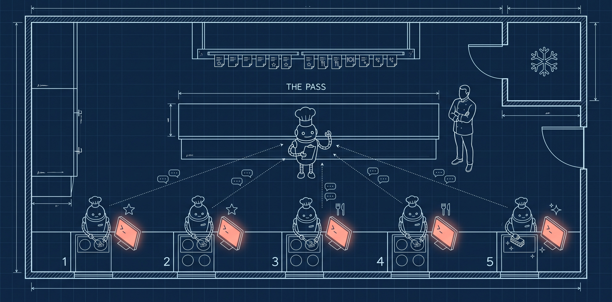

# The Brigade

[](https://github.com/mhmzdev/claude-code-brigade/actions/workflows/check.yml)
[](CHANGELOG.md)



Run a kitchen of Claude Code sessions. One **sous chef** leads, a few **line cooks** work
one ticket each at their own **station**, and you are the **head chef**: you approve
feature plans and you merge. The sessions talk to each other with `SendMessage`. There is no
daemon, no queue, and no database.

> Inspired by Steve Yegge's *[The Shape of Things to Come](https://yegge.ai/essays/the-shape-of-things-to-come/)*
> and *[Model Welfare for Agentic Engineers](https://yegge.ai/essays/model-welfare/)*.
> Gas Town is a city of agents. The Brigade is the same idea at the scale of one engineer
> and one laptop.

## Contents

- [Why a kitchen](#why-a-kitchen)
- [The cast](#the-cast)
- [The three lanes](#the-three-lanes)
- [The rules](#the-rules)
- [Install](#install)
  - [Update](#update)
- [Set up a repo](#set-up-a-repo)
- [Stations: clones or worktrees](#stations-clones-or-worktrees)
- [Run a service](#run-a-service)
- [What a service looks like](#what-a-service-looks-like)
- [Long services: clearing sessions](#long-services-clearing-sessions)
- [What's in the box](#whats-in-the-box)
- [Troubleshooting](#troubleshooting)
- [Feedback](#feedback)
- [Honest limits](#honest-limits)
- [Status](#status)

## Why a kitchen

A professional kitchen already solved this problem: several people working in parallel,
in one shared room, under time pressure, with one person checking every plate before it
goes out. Escoffier's *brigade de cuisine* gives every station one owner, turns every order
into a ticket, and puts one gate between the kitchen and the customer: **the pass**.

## The cast

| Kitchen | In the harness |
|---|---|
| **Head Chef** | you: decide what nobody has decided yet (features, real forks), merge, deploy |
| **Sous Chef** | the lead session: assigns tickets, answers every question the record or routine settles, signs off bug, chore and hygiene plans, keeps the record, is the only one who writes the rail, reviews every diff at the pass |
| **Line Cook** | a worker session: one ticket, plan to PR; sends the commis before it sends a question |
| **Commis** | `commis`, a read-only sub-agent on Opus: searches the record (decisions, conventions, knowledge, open questions, specs, journals) before any question goes up, and returns a verdict with sources |
| **Station** | a gitignored clone at `stations/station-N` |
| **The Walk-in** | shared local resources (a database, a docker stack) that one cook could break for everyone |
| **The Rail** | where tickets live: markdown in `docs/` (default), GitHub Projects, or Jira |
| **Health Inspector** | `inspector`, a report-only sub-agent: flags what a reviewer would reject in a diff |
| **Taster** | `taster`, a sub-agent the sous sends to the pass: reads the diff, re-runs the check, walks "Done when", returns a verdict |
| **Runner** | `runner`, a sub-agent anyone uses to run a noisy command and get back only pass/fail plus the failing lines |

The full table, plus an Urdu alternate (Qafila), is in [`docs/the-names.md`](docs/the-names.md).
How each flow runs, question by question, is in [`PLAYBOOK.md`](PLAYBOOK.md).

## The three lanes

| Lane | Source | Path |
|---|---|---|
| **A — Specials** | a spec, sliced into tickets | (brainstorm or pick-ticket) → grill-me → spec → file-tickets → create-plan → implement → review-task → open-pr |
| **B — À la carte** | bugs and chores on the backlog (`kind: bug`, `kind: chore`). Every other backlog item becomes a spec and tickets first | pick-ticket → (grill-me) → create-plan → implement → review-task → open-pr |
| **C — Clean as you go** | the kitchen finds its own mess: `/bk:clean scan` | pick-ticket → implement → open-pr |

## The rules

1. **One cook, one ticket, one shift.** Clear the session before its next ticket.
2. **If it's on the rail, it's taken**, even if you can't see the plan: it's in another station.
3. **Nobody empties the walk-in without calling it.** Ask the sous before a reset.
4. **One migration in flight at a time.**
5. **Two tickets on the same files go to the same cook**, in sequence.
6. **The chef signs the specials, the sous checks every plate.** Feature plans need your yes; bug, chore and hygiene plans the sous signs and tells you. The sous never speaks for the chef on merge or deploy.
7. **Call for decisions, not ceremony.** The commis searches the record first, the sous answers what it settles, and only a decision nobody has made reaches you. Once you've answered, it's in the record, and you're never asked it twice.
8. **Trust the cook at the station.** When a cook says the sous is wrong about its station, the cook wins.

## Install

Skills are invoked as `/bk:<skill>`, where `bk` is short for *brigade kitchen*.

In Claude Code:

```
/plugin marketplace add mhmzdev/claude-code-brigade
/plugin install bk@claude-code-brigade
```

Or commit it for your whole team in `.claude/settings.json`:

```json
{
  "extraKnownMarketplaces": {
    "claude-code-brigade": {
      "source": { "source": "github", "repo": "mhmzdev/claude-code-brigade" }
    }
  },
  "enabledPlugins": { "bk@claude-code-brigade": true }
}
```

You need a Claude Code version where sessions on one machine can see each other
(`ListAgents`) and message each other (`SendMessage`). All sessions must run under the
same `CLAUDE_CONFIG_DIR`.

### Update

New versions land on `main`. Fetch the latest marketplace, then update the plugin:

```
/plugin marketplace update claude-code-brigade
```

```bash
claude plugin update bk@claude-code-brigade
```

Or do both from the `/plugin` menu. Then **restart every session**, the sous and each cook:
a running session keeps the version it started with. [`CHANGELOG.md`](CHANGELOG.md) says
what changed in each version.

## Set up a repo

At the repo root, with a clean working tree:

```
/bk:setup               # detects the station kind and recommends it
/bk:setup --worktree    # or pick it yourself: worktrees next to the repo
/bk:setup --clone       #                      clones inside the repo
```

Run it **inside the product repo** you want to work on. In a workspace that holds several
repos, `cd` into one of them first. Setup refuses a workspace root, because a station
cloned from it would contain none of the repos inside it.

It reads the repo, asks one round of questions, and writes:

```
.claude/brigade.md          # config: trunk, check command, walk-in, rail adapter
docs/specs/001-<slug>.md    # specs; their tickets in docs/specs/001-<slug>/01-<slug>.md
docs/backlog/BKLG-001-*.md  # backlog items, not yet specced;  HYG-001-*.md for hygiene
docs/plans/  docs/checklists/  docs/journal/  docs/research/  docs/brainstorm/
docs/decisions/  docs/conventions/  docs/domains/  docs/questions/   # the record (or your own folders)
docs/SCHEMA.md              # what each doc type is, unless the repo has its own
stations/station-1 …        # gitignored clones, one per cook
```

It ends with **one** question: *commit, push, create the stations and open the kitchen?*
It's one step because stations are fresh clones of `origin/<trunk>`: until the setup is
pushed, a station would start without it.

Tickets carry their status in frontmatter. There is no summary page to keep in sync:
`kitchen.sh rail` computes the board each time.

## Stations: clones or worktrees

Each cook works in a **station**. There are two kinds, set by `kitchen_mode:` in
`.claude/brigade.md`:

| | `clone` (default) | `worktree` |
|---|---|---|
| Where | `<repo>/stations/station-N`, gitignored | `../<repo>-stations/station-N`, next to the repo |
| What | a full clone | a git worktree: one shared history, one `git fetch` |
| Best for | one standalone repo | big repos, and repos inside a workspace repo |
| Idle station | on trunk | detached at `origin/<trunk>` (trunk is checked out in your main folder) |

A workspace that holds several repos, each gitignored by the outer repo, can't be cloned
per station. Worktrees handle it: `<repo>/` keeps its stations in
`<repo>-stations/`, and setup adds that folder to the **workspace's**
`.gitignore`. Cooks there also load the workspace's `CLAUDE.md`.

Two worktree habits: stashes are shared between stations (stash with
`-m "<station>: …"` and apply only your own), and remove stations with
`/bk:kitchen remove`, never `rm -rf`. `/bk:setup` recommends the mode for you, or pass `--worktree` / `--clone`.

## Run a service

1. In the main checkout: `/bk:sous-chef`. With no cooks yet, it tells you so and waits.
2. From the sous (or any terminal): `/bk:kitchen open`. Each station opens **already running
   `/bk:line-cook`**, finds the sous and checks in. There's nothing to type in the stations.
3. The sous puts each free cook on the next ready ticket and tells you what it assigned:
   `priority: high` first, then whatever unblocks the most, then spec tickets before
   backlog bugs before hygiene, oldest first. Steer it by
   saying what comes first or what to hold. To make it ask first, set `gates.assign: head-chef`.

A cook's plan and checklist are written in its station and reach trunk with its PR, not
before. Specs and tickets are written by the sous in the main checkout and reach trunk
straight away.

**Cook names.** `kitchen open` names the session in station-N `<repo>-cook-N` (Claude
Code's `--name`), e.g. `my_app-cook-2`: the station is the place, the cook is who works
there. It's the name in the terminal title, in `/resume`, and in the sous's session list;
the repo prefix keeps two kitchens on one machine apart. Cooks start in Claude Code's
`auto` permission mode, since nobody watches their terminals between gates (set
`permission_mode:` in the config to change it).

**The start order doesn't matter.** A cook that comes up before the sous says it's waiting;
when the sous starts it sends `[hello]` to cooks in its stations, and they check in. The
sous also records its own session name (`kitchen.sh sous`), so a cook that's restarted or
cleared later finds it and checks in by itself. Prefer
plain sessions? `kitchen open --bare`, then name them to the sous (`/bk:sous-chef @one @two`);
its brief tells each one it's a line cook.

**You talk to one session: the sous.** Cooks never ask you anything, and you don't need to
watch their terminals. The one exception is a grilling the sous hands to a free cook: it
tells you which station is waiting, and you answer the questions there. Invoking a skill *is* the approval for its whole job, so no skill
asks "does this look right?" or "go on to phase 2?". Per feature ticket, two things need
you: a yes to the plan, which the sous shows you with its recommendation, and the merge.
Per bug or chore, only the merge. Real
design forks reach you through the sous too, the same way.

**Test logins are set up once.** Put the accounts sessions may test with in
`.claude/brigade.local.md` (gitignored), under `## Test accounts`: one block each for local,
stage and production. A cook asks the sous for an account and gets its name; the password
never goes into a message or a committed file, and `kitchen.sh leaks` checks every diff,
commit message and PR body for it. If no account fits, the sous asks you once to add it to
the file. Production is read-only unless you approve one specific write.

**One file shows the current state.** The sous keeps `.claude/board.md` current: stations,
files in flight, the rail and open questions. It's generated by `kitchen.sh board`, never
edited and never committed. Leave it open; `/bk:kitchen board` refreshes it on demand.

## What a service looks like

Sessions talk in short typed messages, so you can follow a ticket by reading them:

```
cook  → sous   [check-in]  station-1 · Opus · main · clean · no ticket
sous  → cook   [brief]     BKLG-001: /abs/path/to/ticket.md, constraints, the loop
cook  → sous   [rail]      claim BKLG-001 todo
                           … the cook writes the plan …
cook  → sous   [plan]      BKLG-001 ready: /abs/path/to/plan.md
sous  → cook   [approved]  BKLG-001: /abs/path/to/plan.md · sous, per gates.plan_approval.bug   → the cook starts /bk:implement
sous  → you                "approved station-1's plan for BKLG-001 (bug): …"   ← one line, no question
                           (a feature plan comes to you instead: "approve?", and your yes is relayed)
cook  → sous   [rail]      BKLG-001 → in-progress
                           … the cook hits a question: it spawns the commis; settled → journal, no gate …
cook  → sous   [gate]      BKLG-001 Q1, see journal. commis: nothing recorded → sous answers; cook copies it in as A1
cook  → sous   [handoff]   ready for the pass: branch, files, check green, inspector clean
                           … the sous sends the taster; reads its verdict …
sous  → cook   [findings]  1. file:line — why   (or)   [go]
                           … on [go]: clean around, handoff into the journal, then open-pr …
cook  → sous   [served]    PR #12
sous  → PR                 LGTM comment
                           … YOU merge; the sous closes BKLG-001 on the rail …
```

Only two kinds of moment need you: a decision nobody has made yet (a feature plan, a real
fork the record doesn't settle) and the merge. Both come to you in the sous's terminal.
Everything routine stays between the sous and the cooks, everything already decided is
found by the commis, and everything you decide is written down so it isn't asked again.

## Long services: clearing sessions

A model works best early in its context window; well before it's full, the noise starts to
cost. The Brigade treats a context window as a **cache, not the record**. Everything a fresh
session needs is on disk, so any session can be cleared at a quiet point and a new one carries
on. No `/compact` needed.

| What | Where | Written by |
|---|---|---|
| tickets and their status | the rail (`docs/specs/`, `docs/backlog/`) | the sous |
| a ticket's plan and checklist | `docs/plans/`, `docs/checklists/` | its cook |
| **a ticket's journal**: questions and answers, findings, decisions, handoffs, lessons | `docs/journal/<ID>-<slug>.md`, lands with the PR | its cook, only |
| **the record**: decisions you made that outlive a ticket (ADRs), conventions, domain knowledge, open questions | `docs/decisions/`, `docs/conventions/`, `docs/domains/`, `docs/questions/` (the config's `docs:` map; a repo's own folders if it has them) | the sous, at its handoff |
| the inbox: what you said in passing that nothing recorded yet | `.claude/inbox.md`, kept out of git | the sous, as it hears it |
| the sous's own notes: your standing instructions, what's next | `.claude/sous-handoff.md`, gitignored | the sous |

- **Cooks:** `/clear` after every PR, as always. Clearing mid-ticket is fine too: run
  `/bk:handoff`, `/clear`, then `/bk:line-cook`. A session inside a station knows it's a
  cook: it resumes from the journal's last handoff and checks in with the sous.
- **The sous:** when its context grows (you'll see it in the status line), run `/bk:handoff`,
  `/clear`, `/bk:sous-chef`. The new sous reads its note, lists open questions
  (`kitchen.sh questions`), and says hello; cooks re-send whatever they were waiting on.
- **Less to clear in the first place:** the sous reviews through the `taster`, and anyone can
  push noisy commands through the `runner`, so diffs and logs stay out of the main context.

**Lessons are promoted by rule, not by mood.** Cooks write one-line `lesson(repo)` or
`lesson(plugin)` entries in their journal handoffs. At each sous handoff, `kitchen.sh lessons`
counts them by ticket: a repo lesson seen in two tickets becomes a ticket to promote it into
`CLAUDE.md` (reviewed and merged like any change); a lesson about the Brigade itself becomes a
drafted issue on this repo (through `/bk:feedback`), filed only on your OK.

**And so is the record.** Every answer you give lands in a journal marked `(head chef)`. At the
same handoff, `kitchen.sh decisions` lists the ones nothing cites yet and the sous files those
that outlive their ticket as decisions, in your words plus a structured version;
`kitchen.sh questions` lists what you haven't answered and parks it as a question file that
blocks its ticket, so nobody asks it twice while it waits; `kitchen.sh inbox` lists what you
said in passing and the sous files it into the right doc. Before any question reaches you,
the `commis` has searched all of it. The kitchen asks you less every shift.

## What's in the box

| Skill | Does |
|---|---|
| `setup` | set up a repo |
| `kitchen` | stations: setup, open, sync, status, files in flight, the rail board; the record's lists (`questions`, `decisions`, `inbox`) and `doctor` |
| `sous-chef` / `line-cook` | take the lead or worker role |
| `rail` | list, read, claim, fire, link, close: markdown, GitHub or Jira |
| `brainstorm` · `grill-me` · `spec` · `file-tickets` | lane A, from idea to tickets. `file-tickets` also adds backlog items |
| `pick-ticket` · `create-plan` · `implement` · `review-task` · `open-pr` | from ticket to PR. `implement` starts on the sign-off: yours for a feature (given solo, relayed by the sous in a kitchen), the sous's own for a bug, chore or hygiene ticket |
| `clean` | `check` your own diff (every ticket), `around` your station at end of shift, `scan` the kitchen; hygiene drafts go to the sous |
| `handoff` | write this session's handoff (cook: journal section; sous: local note) so it can be cleared |
| `feedback` | send feedback about the Brigade to its maintainers as a GitHub issue; you see every word first |
| agents: `commis` · `taster` · `runner` · `inspector` | search the record before any question · review at the pass · run noisy commands · report what a reviewer would reject |

Every skill works **solo** too: without a sous, you are both chef and sous.
The shared rules every skill follows are in [`plugins/bk/skills/README.md`](plugins/bk/skills/README.md).

## Troubleshooting

| You see | Why | Do |
|---|---|---|
| `kitchen open`: "No stations yet" | stations haven't been created, usually because the setup isn't pushed | commit + push the setup, then `/bk:kitchen setup` (or just run `/bk:kitchen open` and say yes) |
| a station is **dirty right after setup** | the install step, or an edit that reached into `stations/`, changed tracked files | `git -C stations/station-N diff`, fix the cause in the main checkout, then `git -C stations/station-N checkout -- .` |
| the sous can't find a cook (or the reverse) | sessions only see each other under the same Claude Code profile | start every session with the same `CLAUDE_CONFIG_DIR` (`kitchen open` passes yours through). To restart a cook by hand, run `.claude/cook` in its station rather than plain `claude`: it keeps the profile |
| "1 plugin failed to update" after upgrading from 0.1 | 0.2 renamed the plugin `brigade` → `bk` | `/plugin uninstall brigade@claude-code-brigade`, `/plugin install bk@claude-code-brigade`, and drop any `brigade@…` line from `.claude/settings*.json` |

## Feedback

Something broke, or you'd like the Brigade to do something? Run:

```
/bk:feedback the sous asked me a routine question instead of answering it
```

It drafts a GitHub issue for this repo with the plugin version and your setup. It asks
whether to include the session: nothing (the default), a short summary, or a short excerpt.
It finds saved sessions under `$CLAUDE_CONFIG_DIR` (or `~/.claude` when that's unset). Your
repo's names, paths, code, ticket ids and secrets are removed, the raw transcript is never
uploaded, and nothing is filed until you've read the whole issue and said yes. Issues here
are public. Without `gh`, it gives you the text and a link to paste it into.

You can also [open an issue](https://github.com/mhmzdev/claude-code-brigade/issues/new?template=feedback.yml) by hand.

## Honest limits

- One machine. Two to five cooks, not a fleet.
- The sous is a second fence, not a replacement for your review. You still merge.
- It costs more tokens than one session. Use it when the work is really parallel.
- Stations live inside the repo, gitignored. **Never run `git clean -fdx`** there, and
  exclude `stations/` from tools that don't read `.gitignore` (setup helps with this).

## Status

Every merge to `main` is a release, tagged `vX.Y.Z` with a
[GitHub release](https://github.com/mhmzdev/claude-code-brigade/releases). What changed in
each version, newest first, is in [`CHANGELOG.md`](CHANGELOG.md). Issues and PRs welcome.

MIT © Muhammad Hamza
