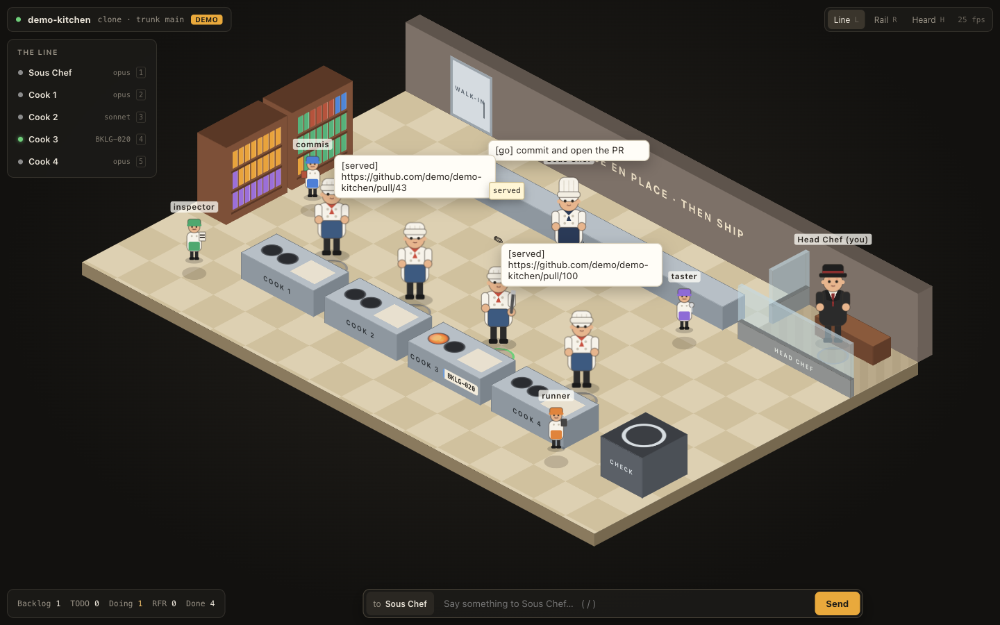

# The Window

A live view of a Brigade kitchen on localhost, drawn as a room in 2.5D: the cooks at their
stations, the sous at the pass, the head chef in the glass office, the commis running to the
record, messages flying between sessions. Drag to turn the room, wheel to zoom. Around it
float what needs you (top), the line (left), the rail or everything heard (a sheet at the
bottom), the composer (foot), and an inspector for the selected figure (right).



From a kitchen, `/bk:live` opens it and `/bk:live` again closes it (`kitchen.sh live` does
the same from a shell). It needs node 20 or newer and nothing else: the room is plain DOM and
CSS 3D, so there is no install step and nothing to vendor. To run it by hand from this folder:

```bash
node server/index.js --root /path/to/the/repo     # the live kitchen (default: the cwd's repo)
node server/index.js --demo                       # a scripted service, to see the room move
node server/index.js --demo --stations 6          # the same service with a longer line
```

Open http://localhost:4747. Options: `--port N`, `--root <repo>`.

Click a cook, the sous or the head chef and the panel turns into that one's page: session,
model, ticket, branch, what it said, and the controls (change model, send a line, handoff, `/clear`). The
`/clear` button stays dim until the sous's handoff is written, or a cook's ticket is served.
Hover anyone for their role. Click the floor or press Esc to go back.

## How the controls reach a session

Claude Code has no outside switch for a session's model or prompt. The only honest route
is typing into the terminal the session runs in, which tmux allows. `kitchen.sh open` starts
the kitchen in tmux (the sous in its own window, one per station), so the Window types
`/model sonnet`, `/clear`, a chat
line, or a question's answer straight into the right pane; you see it land in the
terminal. Without tmux (Warp, Terminal.app) the Window shows you the command to paste.
A question's answer is typed as its option number, then Enter.

## What it reads

- `~/.claude/sessions/*.json` (or `$CLAUDE_CONFIG_DIR`): who is running where, busy or idle.
- each session's transcript under `~/.claude/projects/`, tailed: edits, commands, sub-agent
  spawns, SendMessage calls, AskUserQuestion, your own prompts to the sous.
- each station's git state every five seconds, and the markdown rail's frontmatter.
- the record: one book per markdown page under each folder of the config's `docs` map
  (INDEX files excluded), counted every twenty seconds. The cupboard against the left wall
  fills a shelf per eight pages, three shelves a cupboard, and opens a second cupboard
  beside it; hover it for the count by kind.

How it stays cheap: one Node process with no dependencies, watching files Claude Code
already writes; one Server-Sent Events stream; the room is plain DOM and CSS 3D with the
characters as inline SVG, so the browser composites it and nothing redraws while the room is
still. The only script loop runs while a message is in flight, at most 30 frames a second.

Keys: `1`–`9` select a session, `/` the composer, `i` the inspector, `r` the rail, `h` what was
heard, `l` the line, `g` the question waiting on you (then `a`, `b`, … to answer), `Esc` back.
